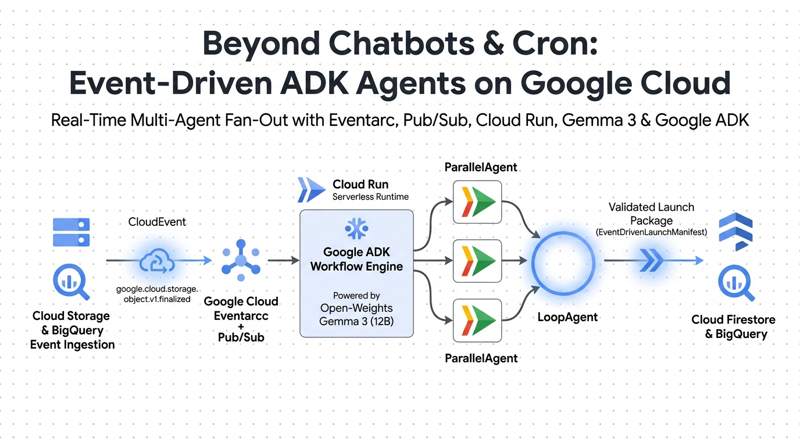
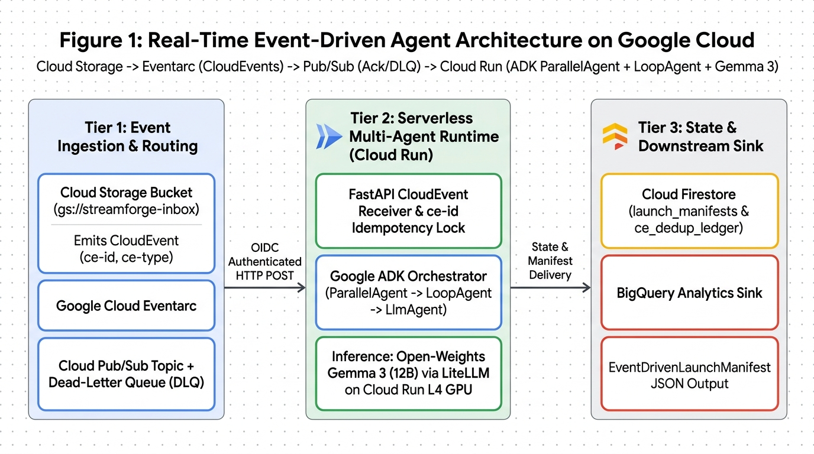
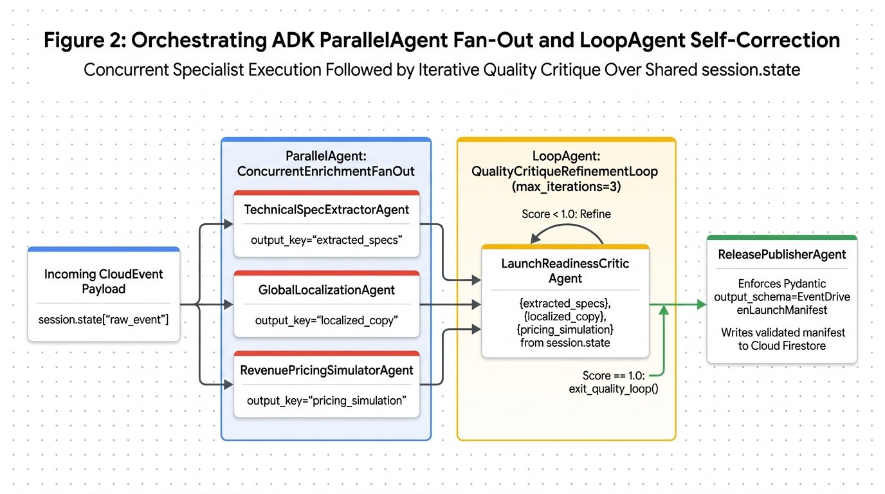

# StreamForge: Real-Time Event-Driven Multi-Agent Pipeline (`Google ADK ParallelAgent & LoopAgent` + `Gemma 3` + `Eventarc` + `Pub/Sub` + `Cloud Run`)

[](https://www.python.org/)
[](https://google.github.io/adk-docs/)
[](https://ai.google.dev/gemma)
[](https://cloud.google.com/eventarc/docs)



**StreamForge** is an end-to-end reference architecture for building **real-time, event-driven multi-agent pipelines** on **Google Cloud**—replacing both manual chat prompts and polling cron jobs with **Google Cloud Eventarc**, **Cloud Pub/Sub**, **Google Agent Development Kit (`ParallelAgent` + `LoopAgent` + `SequentialAgent`)**, and **open-weights Gemma 3 (`gemma3:12b`)** on **Cloud Run**.

Whenever a product engineering or catalog release file lands in **Google Cloud Storage** (`google.cloud.storage.object.v1.finalized`), **Eventarc** pushes a CNCF **CloudEvent** to a private **Cloud Run** service that orchestrates:

1. **Stage 1 — Concurrent Fan-Out (`ParallelAgent: ConcurrentEnrichmentFanOut`):** Runs three specialist `LlmAgent` workers simultaneously (`TechnicalSpecExtractorAgent`, `GlobalLocalizationAgent`, `RevenuePricingSimulatorAgent`), writing their outputs concurrently to `session.state`.
2. **Stage 2 — Self-Correcting Quality Loop (`LoopAgent: QualityCritiqueRefinementLoop`):** `LaunchReadinessCriticAgent` audits cross-agent consistency (such as regional EUR/JPY B2B pricing rounding rules), automatically repairing discrepancies across loop iterations and calling `exit_quality_loop()` (`tool_context.actions.escalate = True`) once `quality_score == 1.0`.
3. **Stage 3 — Validated Sink & CloudEvent Deduplication (`ReleasePublisherAgent`):** Enforces a strict Pydantic `EventDrivenLaunchManifest` schema and records the `ce-id` in Cloud Firestore (`cloudevent_dedup_ledger`) so Pub/Sub at-least-once redeliveries never trigger duplicate GPU inference.



---

## Hybrid ADK Topology (`ParallelAgent` Fan-Out + `LoopAgent` Self-Correction)



---

## Quickstart & Local Verification

```bash
python scripts/simulate_cloudevent_pipeline.py
```

## Deploying to Google Cloud (Eventarc + Pub/Sub + Cloud Run)

```bash
export GOOGLE_CLOUD_PROJECT="your-gcp-project-id"
export GOOGLE_CLOUD_LOCATION="us-central1"

bash deploy/deploy_eventarc_adk.sh
```

---

## 👩‍💻 About the Author

<div align="center">
  

  ### **Robina Mirbahar — Google Cloud & AI Architect**

  

  <p>
    AI Researcher, Cloud Solutions Architect, and Author of <b><i>"AI Engineering: From Classical ML to RAG &amp; Agentic AI Systems"</i> (2026)</b>.<br/>
    Bridging cutting-edge open-weights AI research (Gemma 4, Google ADK, Multi-LoRA, MCP &amp; A2A) with production-grade Cloud Run &amp; Vertex AI engineering.
  </p>

  [](https://linkedin.com/in/robinamirbahar)
  [-FF9900?style=for-the-badge&logo=amazon&logoColor=white)](https://amazon.com/dp/B0GWCZWCF4)
  [](https://developers.google.com/profile/u/106918534005910641104)
  [](https://dev.to/robinamirbahar)
  [](https://medium.com/@robinamirbahar)
  [](https://www.youtube.com/@robinacodesai)
  [](https://twitter.com/robinamirbahar)
  [](https://stackoverflow.com/users/21196122/robina-mirbahar)
  [](https://www.credly.com/users/robinamirbahar)

</div>

### 🚀 Featured Google Cloud & Agentic AI Repositories by Robina Mirbahar

| Repository | Architecture Focus | Live Repo & Dynamic Status |
| :--- | :--- | :--- |
| **[gemma4-multilora-adk-eval](https://github.com/RobinaMirbahar/gemma4-multilora-adk-eval)** | Dynamic Multi-LoRA Hot-Swapping & CI/CD Agent Evaluation (`adk eval`) on Cloud Run GPUs with Gemma 4 & vLLM |   |
| **[slothsre-napops](https://github.com/RobinaMirbahar/slothsre-napops)** | SlothSRE ("NapOps") — Overnight Gemma 4 & Google ADK Incident Digest Agent with OpenTelemetry & Sentry AI Monitoring |   |
| **[streamforge-event-adk](https://github.com/RobinaMirbahar/streamforge-event-adk)** | Real-Time Event-Driven Multi-Agent Pipelines on Google Cloud with ADK (`ParallelAgent` & `LoopAgent`), Eventarc & Pub/Sub |   |
| **[a2a-mcp-mesh-cloudrun](https://github.com/RobinaMirbahar/a2a-mcp-mesh-cloudrun)** | Agent-to-Agent (A2A) & Multi-MCP Mesh on Cloud Run with Gemma 4, Google ADK, Spanner Graph & AlloyDB |   |
| **[cloudguard-gemma-agent](https://github.com/RobinaMirbahar/cloudguard-gemma-agent)** | 6-Part Production Gemma Enterprise Agent Series (ADK, Cloud Run L4 GPU, Firestore, Model Armor, Vertex AI QLoRA) |   |
| **[cozy-ai-agent-cafe-game](https://github.com/RobinaMirbahar/cozy-ai-agent-cafe-game)** | Prompt Paws: 60 FPS Cozy AI Agent Bakery Simulation Game teaching RAG, Guardrails, Context Caching & Multi-Agent Loops |   |

<div align="center">
  
</div>

---

## Star, Fork & Sponsor This Project

[](https://github.com/RobinaMirbahar/streamforge-event-adk)
[](https://github.com/RobinaMirbahar/streamforge-event-adk/fork)
[](https://github.com/sponsors/RobinaMirbahar)

If this project is helpful to your work:
* **Star this Repository:** [**Star `RobinaMirbahar/streamforge-event-adk` on GitHub**](https://github.com/RobinaMirbahar/streamforge-event-adk) to bookmark it and help others discover it.
* **Fork & Customize:** [**Fork `RobinaMirbahar/streamforge-event-adk`**](https://github.com/RobinaMirbahar/streamforge-event-adk/fork) to build and experiment with your own workflows.
* **Sponsor on GitHub:** [**Sponsor `@RobinaMirbahar` on GitHub Sponsors (`github.com/sponsors/RobinaMirbahar`)**](https://github.com/sponsors/RobinaMirbahar) to support open-source AI, Google Cloud, and Gemini engineering projects!

