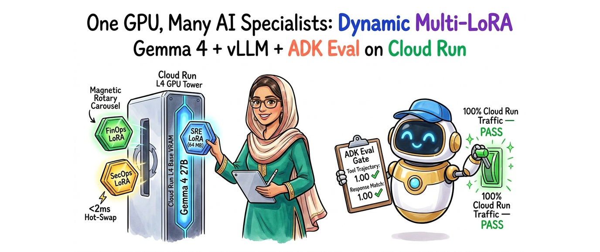
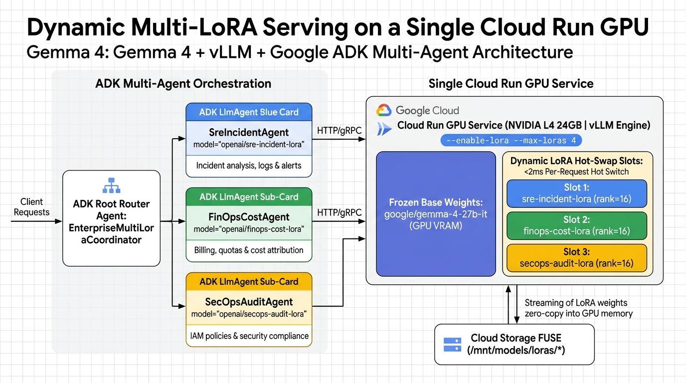
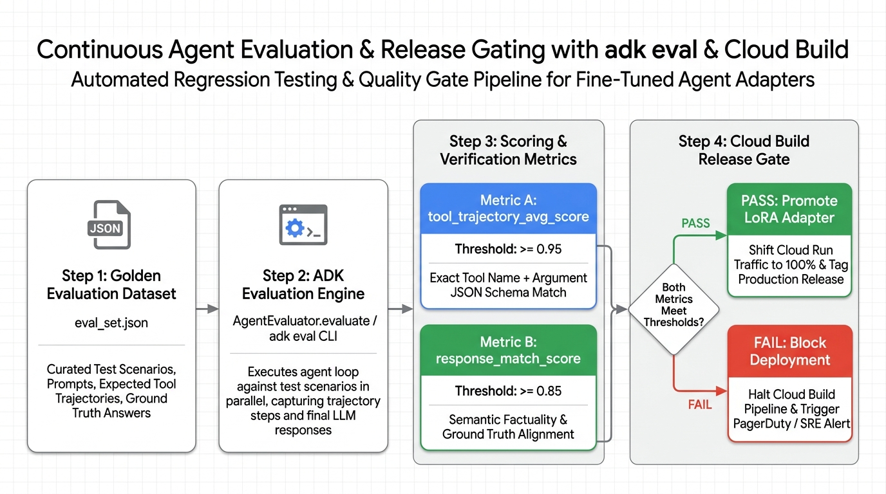

# Dynamic Multi-LoRA Hot-Swapping & CI/CD Agent Evaluation (`adk eval`) on Cloud Run GPUs with Gemma 4 & vLLM



Official reference repository for the hands-on Google Codelab: **Dynamic Multi-LoRA Hot-Swapping & CI/CD Agent Evaluation (`adk eval`) on Cloud Run GPUs with Gemma 4 & vLLM**.

---

## Architectural Overview

Instead of deploying three separate Cloud Run GPU services for three fine-tuned specialist agents, this architecture loads frozen open-weights **Gemma 4 (`google/gemma-4-27b-it`)** once into a single **Cloud Run NVIDIA L4 GPU** and dynamically hot-swaps lightweight rank-16 QLoRA adapters (~64.5 MB VRAM overhead each) from **Cloud Storage FUSE** (`/mnt/models/loras/*`) in under **2 milliseconds**:



Every prompt or LoRA adapter update is gated in **Google Cloud Build** using **Google ADK's evaluation framework (`adk eval`)** across two deterministic metrics before shifting production traffic:
* **`tool_trajectory_avg_score` ($\ge 0.95$):** Verifies exact tool-call sequence and JSON arguments.
* **`response_match_score` ($\ge 0.85$):** Verifies ROUGE token-level factuality against the Golden Evaluation Dataset.



---

## Project Structure

```text
streamforge-event-adk/
├── requirements.txt
├── Dockerfile
├── .dockerignore
├── multilora_adk_eval/
│   ├── schemas.py                 # Pydantic v2 schemas for LoRA metadata & eval scores
│   ├── vllm_multilora_router.py   # Runtime LoRA hot-loader (POST /v1/load_lora_adapter)
│   ├── agent.py                   # 3-specialist Google ADK Multi-LoRA Coordinator
│   ├── golden_eval_set.json       # ADK Golden Evaluation Dataset
│   └── eval_config.json           # Release gate threshold config (0.95 / 0.85)
├── scripts/
│   └── run_multilora_adk_eval.py  # Multi-LoRA vs. Base Gemma 4 evaluation harness
└── deploy/
    ├── deploy_multilora_cloud_run.sh  # Cloud Run NVIDIA L4 GPU + GCS FUSE deployment
    └── cloudbuild_adk_eval.yaml       # 3-step Cloud Build CI/CD release gate
```

---

## Quick Start (Google Cloud Shell)

```bash
git clone https://github.com/RobinaMirbahar/streamforge-event-adk.git
cd streamforge-event-adk

python3 -m venv .venv
source .venv/bin/activate
pip install -r requirements.txt

# Run the Multi-LoRA vs. Base Gemma 4 ADK Evaluation Suite
python3 scripts/run_multilora_adk_eval.py
```

### Expected Output

```text
========================================================================================
[STAGE 1] Hot-Loading 3 Domain QLoRA Adapters into Shared Gemma 4 vLLM Server
========================================================================================
  [HOT-LOADED] sre-incident-lora    -> /mnt/models/loras/sre-incident-v1 (rank=16, VRAM=+64.5 MB)
  [HOT-LOADED] finops-cost-lora     -> /mnt/models/loras/finops-cost-v1 (rank=16, VRAM=+64.5 MB)
  [HOT-LOADED] secops-audit-lora    -> /mnt/models/loras/secops-audit-v1 (rank=16, VRAM=+64.5 MB)

========================================================================================
[STAGE 3] CI/CD Release Gate Verdict (adk eval)
========================================================================================
  Base Gemma 4 Tool Trajectory Avg      : 0.33 (FAIL < 0.95)
  Multi-LoRA Tool Trajectory Avg        : 1.00 (PASS >= 0.95)
  Multi-LoRA Response Factuality Avg    : 1.00 (PASS >= 0.85)
  Cloud Build Traffic Promotion Gate    : APPROVED (100% TRAFFIC)
```

---

## Author

**Robina Mirbahar** — Google Cloud & AI Architect
